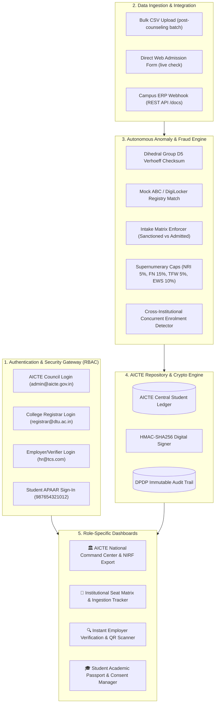
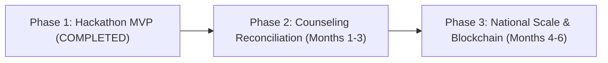

# Updated Implementation Plan: APAAR ID-Based Student Data Management & Verification Platform for AICTE
**Problem Statement ID:** 26263  
**Platform Name:** **VidyaPraman** *(AICTE-APAAR Unified Student Lifecycle, Intake Monitoring & Verification Ecosystem)*  
**Current Implementation Status:** **Phase 1 MVP Fully Implemented & Live** (All 10 PS Requirements Fulfilled)  
**Codebase Path:** `C:\Users\TUSHAR RAJPUT\.gemini\antigravity\scratch\aicte-apaar-vidyapraman`  
**Live Access:** [http://localhost:8000](http://localhost:8000) | Login Gateway: [http://localhost:8000/login.html](http://localhost:8000/login.html) | Swagger: [http://localhost:8000/docs](http://localhost:8000/docs)

---

## 1. Executive Status & Requirements Compliance Matrix

| Requirement from PS 26263 | Status | Implementation Details | File Reference |
|---|:---:|---|---|
| **1. Secure Upload & Update Platform** | ✅ **DONE** | Bulk CSV/Excel batch ingestion engine + RESTful JSON Webhook APIs for institutional ERPs (SAP, TCS iON, CollPoll). | [`backend/main.py`](file:///C:/Users/TUSHAR%20RAJPUT/.gemini/antigravity/scratch/aicte-apaar-vidyapraman/backend/main.py) (`/api/upload`) |
| **2. Comprehensive Seat Fields** | ✅ **DONE** | Captures Sanctioned Regular Intake, Supernumerary (TFW, EWS, PMSSS), and Special/International (NRI, OCI, FN, CIWG). | [`backend/database.py`](file:///C:/Users/TUSHAR%20RAJPUT/.gemini/antigravity/scratch/aicte-apaar-vidyapraman/backend/database.py) (`sanctioned_intakes`) |
| **3. Automated Validation & Anomalies** | ✅ **DONE** | • **Verhoeff Checksum**: Mathematically verifies 12-digit Dihedral $D_5$ check digit. • **Intake Breach Engine**: Blocks excess admissions over approved capacity. • **Quota Guard**: Enforces NRI $\le 5\%$, FN $\le 15\%$, TFW $\le 5\%$, EWS $\le 10\%$. • **Cross-College Duplicate Detector**: Flags same APAAR in multiple full-time degrees. | [`backend/apaar_validator.py`](file:///C:/Users/TUSHAR%20RAJPUT/.gemini/antigravity/scratch/aicte-apaar-vidyapraman/backend/apaar_validator.py) [`backend/anomaly_detector.py`](file:///C:/Users/TUSHAR%20RAJPUT/.gemini/antigravity/scratch/aicte-apaar-vidyapraman/backend/anomaly_detector.py) |
| **4. Dual Real-Time Dashboards** | ✅ **DONE** | • **AICTE Council Command**: State intake heatmaps, admission gauges, real-time anomaly triage feed. • **College Portal**: Visual seat matrix progress bars and drag-and-drop CSV dropzone. | [`static/index.html`](file:///C:/Users/TUSHAR%20RAJPUT/.gemini/antigravity/scratch/aicte-apaar-vidyapraman/static/index.html) (Tabs 1 & 2) |
| **5. Secure Verification Mechanism** | ✅ **DONE** | Instant verification by scanning cryptographic QR codes or querying APAAR ID. Zero-Knowledge DPDP compliance. | [`backend/verifier_engine.py`](file:///C:/Users/TUSHAR%20RAJPUT/.gemini/antigravity/scratch/aicte-apaar-vidyapraman/backend/verifier_engine.py) [`static/index.html`](file:///C:/Users/TUSHAR%20RAJPUT/.gemini/antigravity/scratch/aicte-apaar-vidyapraman/static/index.html) (Tab 3) |
| **6. Verifiable Student Records** | ✅ **DONE** | HMAC-SHA256 digital signature embedded into student records linked directly to the AICTE central repository. | [`backend/verifier_engine.py`](file:///C:/Users/TUSHAR%20RAJPUT/.gemini/antigravity/scratch/aicte-apaar-vidyapraman/backend/verifier_engine.py) |
| **7. Campus ERP Integration** | ✅ **DONE** | Standardized REST API endpoints documented with interactive OpenAPI Swagger UI (`/docs`). | [`backend/main.py`](file:///C:/Users/TUSHAR%20RAJPUT/.gemini/antigravity/scratch/aicte-apaar-vidyapraman/backend/main.py) |
| **8. Security, RBAC & Consent** | ✅ **DONE** | Multi-Role Authentication Gateway (`login.html`), SHA-256 password hashing, DPDP Act 2023 consent toggle, immutable audit trail. | [`static/login.html`](file:///C:/Users/TUSHAR%20RAJPUT/.gemini/antigravity/scratch/aicte-apaar-vidyapraman/static/login.html) [`backend/main.py`](file:///C:/Users/TUSHAR%20RAJPUT/.gemini/antigravity/scratch/aicte-apaar-vidyapraman/backend/main.py) (`/api/auth/login`) |
| **9. Policy & NIRF/NBA Reporting** | ✅ **DONE** | 1-Click download of verified student datasets in CSV/Excel format for NIRF, NBA, and NAAC accreditation compliance. | [`backend/main.py`](file:///C:/Users/TUSHAR%20RAJPUT/.gemini/antigravity/scratch/aicte-apaar-vidyapraman/backend/main.py) (`/api/export/nirf`) |
| **10. Degree Printing Support** | ✅ **DONE** | High-security official credential template displaying **APAAR ID + Institutional Student Roll ID** alongside a tamper-proof signed QR code. | [`backend/verifier_engine.py`](file:///C:/Users/TUSHAR%20RAJPUT/.gemini/antigravity/scratch/aicte-apaar-vidyapraman/backend/verifier_engine.py) [`main.py`](file:///C:/Users/TUSHAR%20RAJPUT/.gemini/antigravity/scratch/aicte-apaar-vidyapraman/backend/main.py) (`/api/certificate/{apaar_id}`) |

---

## 2. Updated Architecture & System Workflow

---

## 3. Implemented Modules Breakdown

### Module 1: Government Branded Multi-Role Authentication Gateway
* **Frontend:** [`static/login.html`](file:///C:/Users/TUSHAR%20RAJPUT/.gemini/antigravity/scratch/aicte-apaar-vidyapraman/static/login.html)
* **Backend:** `POST /api/auth/login` in [`backend/main.py`](file:///C:/Users/TUSHAR%20RAJPUT/.gemini/antigravity/scratch/aicte-apaar-vidyapraman/backend/main.py)
* **Features:**
  * 4 Selectable Role Tabs: AICTE Council, Institution Nodal Officer, Employer/Verifier, Student/Citizen.
  * 1-Click Demo Profiles (Jury Quick-Fill buttons).
  * Security Captcha Simulator with refresh capability.
  * MeriPehchaan SSO / DigiLocker Single Sign-On simulation.
  * Session token generation and automatic dashboard routing.

### Module 2: Automated Validation & APAAR Engine
* **Engine:** [`backend/apaar_validator.py`](file:///C:/Users/TUSHAR%20RAJPUT/.gemini/antigravity/scratch/aicte-apaar-vidyapraman/backend/apaar_validator.py)
* **Features:**
  * Dihedral Group $D_5$ Verhoeff Algorithm catching 100% of single-digit substitutions and transposition errors.
  * Form factor validation (12 digits, reserved prefixes 0/1 disallowed).
  * Mock Academic Bank of Credits (ABC) & DigiLocker identity reconciliation (Name, DOB, Gender).

### Module 3: Intelligent Anomaly & Fraud Detection Engine
* **Engine:** [`backend/anomaly_detector.py`](file:///C:/Users/TUSHAR%20RAJPUT/.gemini/antigravity/scratch/aicte-apaar-vidyapraman/backend/anomaly_detector.py)
* **Features:**
  * **Intake Cap Breach:** Blocks excess admissions over Sanctioned Intake.
  * **Quota Guard:** Enforces statutory limits (NRI $\le 5\%$, FN $\le 15\%$, TFW $\le 5\%$, EWS $\le 10\%$).
  * **Concurrent Enrolment Detector:** Global cross-institutional check flags duplicate active full-time admissions.
  * **Batch Processing:** Processes hundreds of rows in bulk CSV, returning accepted records and flagged anomalies with severity classifications (`CRITICAL`, `HIGH`, `MEDIUM`).

### Module 4: Dual Dashboards & Real-Time Monitoring
* **Frontend:** [`static/index.html`](file:///C:/Users/TUSHAR%20RAJPUT/.gemini/antigravity/scratch/aicte-apaar-vidyapraman/static/index.html)
* **AICTE National Command:**
  * State-wise approved intake vs actual admission bar charts (Chart.js).
  * Category distribution doughnut chart (Regular, TFW, EWS, NRI, FN, PMSSS).
  * Live Anomaly Triage Center with modal for recording official resolution rationale.
  * 1-Click NIRF/NBA Accreditation CSV Exporter (`/api/export/nirf`).
* **Institution Portal:**
  * Dynamic college switcher locked to logged-in registrar's AICTE ID.
  * Visual seat matrix progress gauges for all approved branches.
  * Bulk CSV Drag-and-Drop Dropzone with instant feedback.
  * Single-student real-time admission form with live Verhoeff feedback.

### Module 5: Cryptographic Verification & Degree Printing Support
* **Engine:** [`backend/verifier_engine.py`](file:///C:/Users/TUSHAR%20RAJPUT/.gemini/antigravity/scratch/aicte-apaar-vidyapraman/backend/verifier_engine.py)
* **Features:**
  * Generates HMAC-SHA256 signatures with secret key for student enrollment records.
  * Generates high-density signed QR codes (Base64 PNG) containing deep verification URL and payload hash.
  * Public Verification Portal with camera/smartphone scanner simulation.
  * Official Verifiable Certificate / Transcript View embedding **APAAR ID + Institutional Student ID** per Requirement 10.

### Module 6: Student Academic Passport & DPDP Consent Ledger
* **Portal Tab:** `tab-student` in [`static/index.html`](file:///C:/Users/TUSHAR%20RAJPUT/.gemini/antigravity/scratch/aicte-apaar-vidyapraman/static/index.html)
* **Features:**
  * Virtual APAAR identity card with Verhoeff seal and signed QR code.
  * Academic Bank of Credits widget (48 accumulated credits).
  * DPDP Act 2023 Consent Manager Toggle: allows students to enable or revoke recruiter background verification.

---

## 4. Hackathon Presentation Assets

| Asset | Format | Location | Purpose |
|---|:---:|---|---|
| **SIH Official Pitch Deck** | `.pptx` | [`presentation/VidyaPraman_SIH_Presentation.pptx`](file:///C:/Users/TUSHAR%20RAJPUT/.gemini/antigravity/scratch/aicte-apaar-vidyapraman/presentation/VidyaPraman_SIH_Presentation.pptx) | 11-Slide formal pitch deck matching the Smart India Hackathon jury template. |
| **Browser Pitch Deck** | `.html` | [`presentation/VidyaPraman_SIH_Deck.html`](file:///C:/Users/TUSHAR%20RAJPUT/.gemini/antigravity/scratch/aicte-apaar-vidyapraman/presentation/VidyaPraman_SIH_Deck.html) | Interactive slide viewer with fullscreen mode and arrow/spacebar controls. |
| **Pitch Generator Script** | `.py` | [`presentation/generate_sih_ppt.py`](file:///C:/Users/TUSHAR%20RAJPUT/.gemini/antigravity/scratch/aicte-apaar-vidyapraman/presentation/generate_sih_ppt.py) | Programmatic generator using `python-pptx` for re-styling or updating slides. |
| **Windows Launcher** | `.bat` | [`run_project.bat`](file:///C:/Users/TUSHAR%20RAJPUT/.gemini/antigravity/scratch/aicte-apaar-vidyapraman/run_project.bat) | 1-Click launcher opening server, browser app, and presentation. |

---

## 5. Demonstration Test Cases for Jury Review

| Test Scenario | Input / Action | Expected Result | System Validation |
|---|---|---|---|
| **1. Authentic Student Verification** | APAAR: `987654321012` | Verified Green Badge: Aarav Sharma (DTU, CSE). | Valid Verhoeff checksum + ABC match + HMAC signature verified. |
| **2. TFW Quota Student** | APAAR: `812345678900` | Verified Green Badge: Priya Nair (COEP Tech, TFW). | Validates supernumerary quota seat allocation. |
| **3. Concurrent Multi-Enrolment Fraud** | APAAR: `918273645018` | Flagged Red Warning: Enrolled concurrently in COEP Tech & BMSCE. | Multi-institution fraud alert; public verification suspended. |
| **4. Invalid APAAR Checksum** | APAAR: `309871234560` | Checksum Error: Fails Verhoeff check-digit calculation. | Blocked from central AICTE ledger. |
| **5. Bulk Ingestion & Anomaly Segregation** | Upload `static/sample_aicte_students.csv` | 6 processed: 3 clean records admitted, 3 invalid records flagged. | Segregates clean vs violating rows in real time. |
| **6. DPDP Consent Toggle** | Toggle switch in Student Passport | Dynamic status update with timestamped audit logging. | Complies with DPDP Act 2023 data principal rights. |

---

## 6. Future Roadmap (Phases 2 & 3)

* **Phase 2 (Immediate Post-Hackathon):**
  * Direct API bridges with State Counseling Authorities (JoSAA, JAC Delhi, MHT-CET, KCET).
  * Automated reconciliation between counseling seat allotment and physical reporting.
  * Integration with the National Scholarship Portal (NSP) to block duplicate disbursement across institutions.
* **Phase 3 (National Deployment):**
  * Onboarding across all 10,000+ AICTE-approved institutions nationwide.
  * Native Mobile Wallet (Android / iOS) for student consent and offline credential storage.
  * W3C Verifiable Credentials (DID:APAAR) integration on DigiLocker.
  * Complete integration with National Educational Technology Forum (NETF) under NEP 2020.
